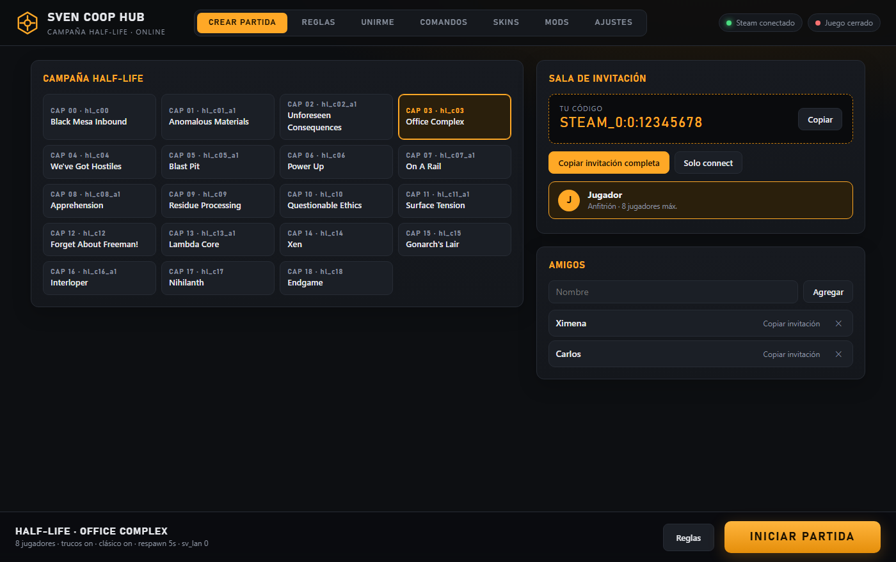
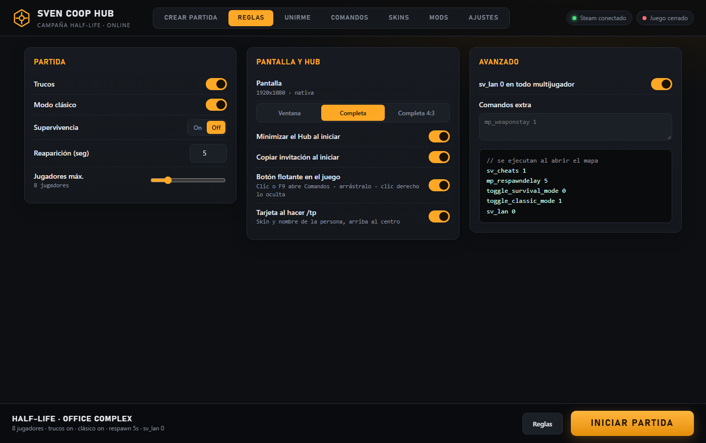
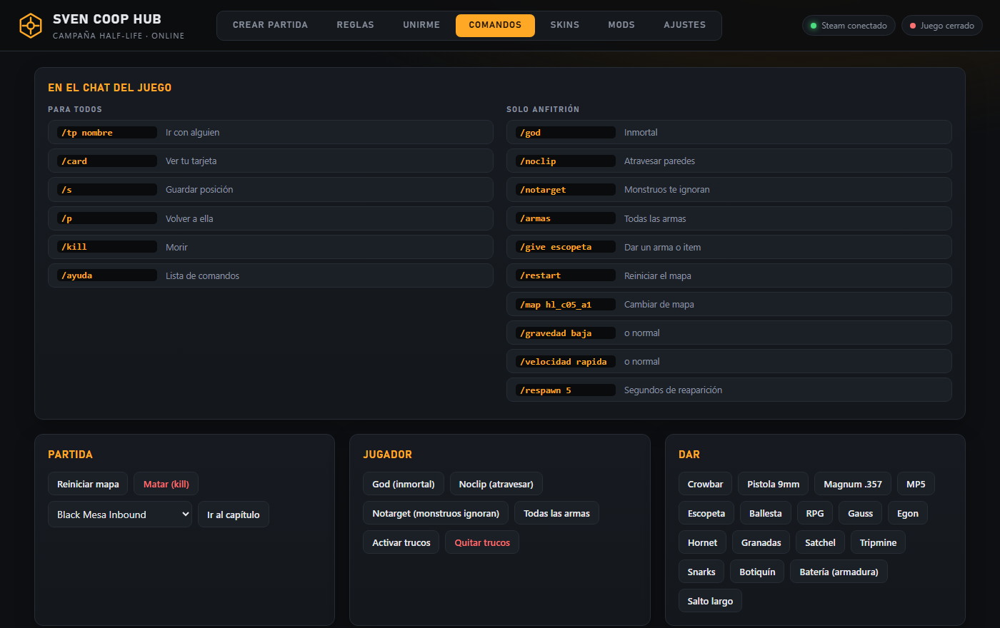
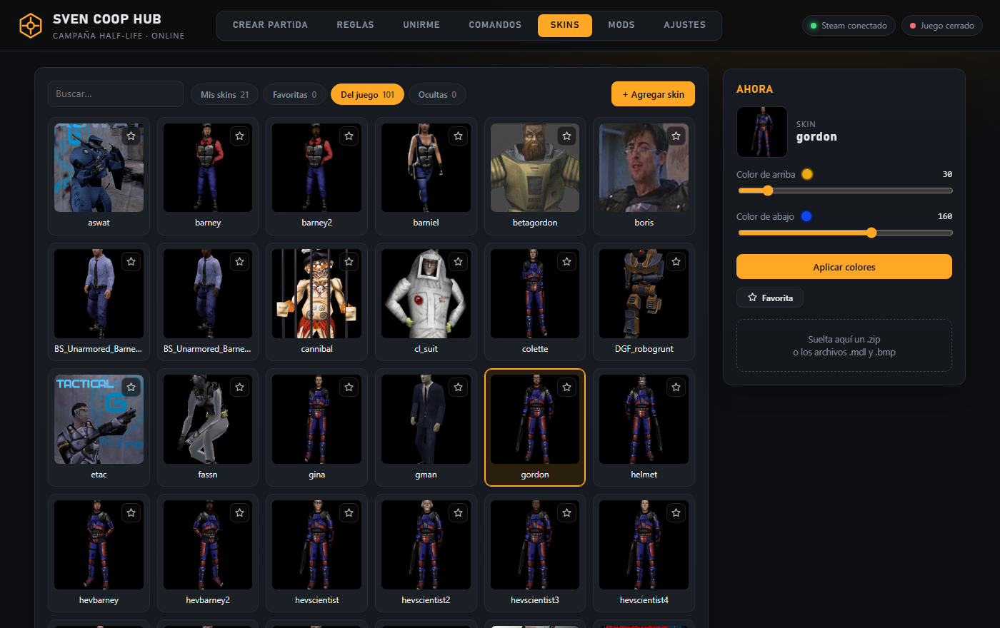
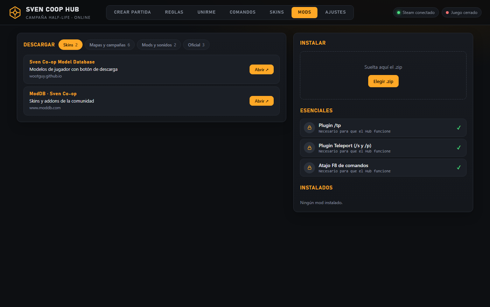

# Sven Coop Hub

Lanzador para jugar la **campaña de Half-Life en Sven Co-op** con amigos: creas la partida, compartes una invitación y ya. Sin tocar consola ni archivos.

**[⬇ Descargar la última versión](https://github.com/podselxd/sven-coop-hub/releases/latest)** (`SvenCoopHub.exe`, un solo archivo)

> Windows puede avisar al abrirlo (no está firmado con certificado de pago): **Más información → Ejecutar de todas formas**.



## Qué hace

- **Crear partida** — eliges mapa y le das a *Iniciar partida*. El Hub escribe la configuración, abre el juego y deja lista la invitación.
- **Unirme** — pegas la invitación de tu amigo (Steam ID) y entras.
- **Reglas** — trucos, modo clásico, supervivencia (On/Off, apagada por defecto), reaparición, jugadores máximos, pantalla completa y comandos extra.
- **Comandos** — comandos de chat y un bind (F8) para lanzarlos; lista con copiar de un clic.
- **Skins** — agrega o borra modelos de jugador desde `.zip`; las skins por defecto se ocultan solas.
- **Mods** — lista por categorías con enlace directo a cada sitio. Lo esencial (plugins y archivos que usa el Hub) no se puede borrar desde aquí.
- **Botón flotante en el juego** (opcional) — un botón semitransparente, movible, que abre Comandos (F9). Al hacer `/tp` aparece una tarjeta con la skin y el nombre de la persona.
- **Reparar todo / Deshacer** — restaura lo que el Hub modificó en el juego; hace copia de lo que cambia.
- **Se actualiza solo** (ver [Actualizaciones y seguridad](#actualizaciones-y-seguridad)).

| Reglas | Comandos |
|---|---|
|  |  |

| Skins | Mods |
|---|---|
|  |  |

## Cómo jugar

**Anfitrión**
1. Abre Steam y ejecuta `SvenCoopHub.exe`.
2. En *Crear partida* elige el mapa → **Iniciar partida**.
3. La invitación se copia sola. Pásasela a tus amigos.

**Invitados**
1. Abre Steam y ejecuta `SvenCoopHub.exe`.
2. En *Unirme* pega la invitación.

Si algo falla: **Ajustes → Reparar todo**.

## Comandos de chat

Se escriben en el chat del juego. Los instala un plugin (`HubTP.as`) que el Hub agrega al juego.

| Para todos | |
|---|---|
| `/tp <nombre>` | Teletransportarte a otra persona |
| `/card` | Mostrar tu tarjeta (skin y nombre) |
| `/kill` | Suicidarte |
| `/ayuda` | Lista de comandos |

| Solo el anfitrión | |
|---|---|
| `/god` · `/noclip` · `/notarget` | Alternar modo dios, noclip y notarget |
| `/armas` | Todas las armas |
| `/give <objeto>` (`/dar`) | Un arma o ítem (`escopeta`, `mp5`, `botiquin`, `bateria`…); sin argumento muestra la lista |
| `/map <mapa>` (`/mapa`) | Cambiar de mapa (solo si existe) |
| `/restart` (`/reiniciar`) | Reiniciar el mapa |
| `/gravedad baja\|normal` | Gravedad |
| `/velocidad rapida\|normal` | Velocidad |
| `/respawn <0-60>` | Segundos de reaparición |

## Actualizaciones y seguridad

- Cada versión publica un `manifest.json` con el SHA-256 de cada archivo y un `manifest.sig` (firma RSA-3072/SHA-256). El Hub lleva dentro la llave pública y **no instala nada si la firma o algún hash no coincide**.
- Antes de instalar se comprueba que los scripts sean válidos; se guarda copia de la versión anterior y, si la nueva no arranca, **vuelve atrás sola**.
- El servidor del Hub solo escucha en `127.0.0.1` y exige un token; no hay telemetría.
- La descarga de skins/mods bloquea rutas fuera de su carpeta (zip-slip) y no instala ejecutables.
- Lo borrado va a la Papelera de reciclaje.

## Requisitos

- Windows 10/11
- Steam con **Sven Co-op** instalado

## Estructura del repositorio

| Ruta | Qué es |
|---|---|
| `files/` | Lo que los Hub descargan al actualizarse (scripts, interfaz, plugin) |
| `manifest.json`, `manifest.sig` | Versión, hashes y firma del canal de actualización |
| `build/` | Scripts de compilación y publicación, y el lanzador (`Stub.cs`) |
| `docs/` | Capturas de este README |
| `pubkey.xml`, `update.url` | Llave pública de verificación y dirección del canal |

El Hub está hecho en PowerShell 5.1 (servidor local `HttpListener`) con interfaz web en una ventana de Edge `--app`, más un pequeño `.exe` en C# que lo empaqueta.

## Compilarlo tú mismo

```powershell
build\make-keys.ps1   # una vez: crea tu par de llaves (la privada queda en ~\.svenhub, nunca se sube)
build\build.ps1       # comprobaciones + SvenCoopHub.exe
build\publish.ps1     # firma y sube la versión al repositorio
```

Si haces un fork, genera tus propias llaves y cambia `update.url`: si no, tus Hub seguirían buscando actualizaciones en este canal (y las rechazarían, porque no llevan mi firma).

## Licencia

Aún sin licencia: todos los derechos reservados. Sven Co-op y Half-Life pertenecen a sus respectivos dueños; este proyecto no está afiliado a ellos.
